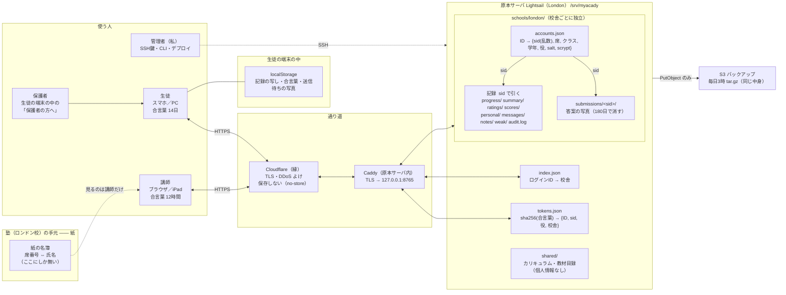

# ガバナンス ―― データはどこにあり、なぜ原理的に安全か（2026-09-13）

登場するのは 5 者と 6 つの置き場所。**氏名はこのシステムのどこにも無い。** それが全体の要。

---

## 1. 誰が、何を、どこまで

| 人 | 入り方 | 読める | 書ける | 持っているもの |
|---|---|---|---|---|
| **生徒** | ID＋パスワード（講師が発行）。合言葉 14日 | 自分の記録・自分の答案・自分宛のお知らせ・自分の家からのメッセージ | 自分の記録・自分の提出・「わかった／質問する」・メッセージ | 端末の localStorage（自分の記録の写し。他人のものは入らない） |
| **保護者** | 生徒の端末の「保護者の方へ」（別の口座は無い） | 子の記録（％つき）・先生の返事 | 先生へのメッセージ | 何も持たない（生徒の端末を借りて見る） |
| **講師** | ID＋パスワード。合言葉 12時間（短い：1人で担当クラス全員が読めるため） | **担当クラス**の生徒の記録・答案・提出状況（席番号で） | 評価・ひとこと・添削の返却・個別の宿題・返事。**生徒の記録は書けない** | **紙の名簿**（席 ⇔ 氏名）。これは手元の紙で、システムの外 |
| **管理者（私）** | SSH 鍵で原本サーバへ。CLI（名簿登録・合言葉再発行・在籍終了・削除・デプロイ） | サーバの中身すべて（ただし氏名は無い） | 口座の作成・停止、コードの更新 | SSH 鍵・AWS の権限 |
| **早稲田アカデミー本部** | ―― | ―― | ―― | **接続していない。** こちらから本部のサーバを読むことも書くこともない |

判定は**すべてサーバ側**（画面側の出し分けは判定ではない）。合言葉の役と校舎は
サーバがファイルから引き、リクエストが名乗る校舎は一切見ない。

---

## 2. 置き場所ごとに、何が入っていて、漏れたら何が分かるか

| 置き場所 | 中身 | 漏れたら分かること | 分からないこと |
|---|---|---|---|
| **紙の名簿（塾の手元）** | 席番号 ⇔ 氏名 | 誰が何番か | 成績・記録（システムに入る鍵は無い） |
| **accounts.json** | ID → 乱数の sid・席・クラス・学年・役・salt・scrypt ハッシュ | 「中2A の 07番」という**席**と、その sid | 氏名（無い）。パスワード（salt付き scrypt、総当たり以外に戻す道が無い） |
| **index.json** | ログインID → 校舎 | どの ID がどの校舎か | 氏名・記録 |
| **tokens.json** | sha256(合言葉) → {ID, sid, 役, 校舎, 発行時刻} | 誰がログイン中か（sid で） | 合言葉そのもの（ハッシュだけ。なりすませない） |
| **progress / summary / ratings / scores / personal / messages / notes / weak** | 学習記録・評価・お知らせ・メッセージ。**鍵は sid** | 「sid X はこう学んだ」 | sid が誰か（accounts.json と紙の名簿の**両方**が要る） |
| **submissions/&lt;sid&gt;/** | 答案の写真（180日で消す。退塾6か月で全消し） | 手書きの字。**本人が紙に名前を書いていれば、それが写る** | ―― ここが最大の残余。下の §4 |
| **audit.log** | 誰（sid）がいつ誰（sid）の何を見たか。追記だけ | 操作の履歴 | 氏名 |
| **shared/** | カリキュラム・教材目録 | 個人情報は無い | ―― |
| **S3 バックアップ** | 上の全部の tar.gz（毎日3時） | 原本と同じ | 原本と同じ（氏名は無い） |
| **生徒の端末** | 自分の記録の写し・合言葉・送信待ちの写真 | その子の分だけ | 他の子 |
| **Cloudflare** | 通り道。API は `no-store` で保存させない | 通過中の中身（縁で TLS を解く方式のため） | 保存はしない |
| **早アカ本部のサーバ** | ―― | ―― | 接続していないので何も |

---

## 3. なぜ「原理的に」安全と言えるか

1. **氏名を最初から持たない。** 名簿登録（`roster-import`）は「氏名／name／名前」の列を見つけたら**登録を拒否**する。持つのは席番号だけ。名前から ID やパスワードを作る仕組みも無い（ID＝校舎コード＋クラス＋席、パスワード＝乱数の単語＋4桁）。
2. **記録の鍵は乱数の sid。** 成績・提出・お知らせ・メッセージはすべて sid で引く。sid → 席 の対応は `accounts.json` だけにあり、席 → 氏名 は**塾の手元の紙**だけにある。つまり実名に辿り着くには **サーバの中身と紙の名簿の両方**が要り、サーバだけが丸ごと漏れても「ある番号の子がこう学んだ」までしか分からない。
3. **パスワードは戻せない形。** salt 付き scrypt（無い環境では pbkdf2 60万回）、照合は定数時間。存在しない ID でも同じ時間・同じ返事（ID の総当たりで的が絞れない）。試行制限（同じ ID に 15分8回、同じ相手に 30回）。
4. **合言葉もハッシュで置く。** `tokens.json` が漏れても、そこに書いてある文字列では入れない。寿命は生徒 14日・講師 12時間。
5. **校舎ごとに閉じる。** 記録は `schools/<校舎>/` の内側にしか置かず、判定はトークンの校舎だけを使う。他校舎の sid は「居ない」と同じ。
6. **判定はサーバだけ。** 生徒は自分の分だけ読み書き、講師は担当クラスを読めるが記録は書けない。他人の記録・答案・見出しはすべて 403（09-13 の自己攻撃で確認）。
7. **持ち続けない。** 写真は 180日で消え、退塾から 6か月で記録ごと消す（`archive` → `purge` の2段階。取り違えを戻せる）。
8. **本部に触らない。** 早アカのサーバへは接続しない。依存も権限も持たない。

---

## 4. 正直に書く残余リスクと、対処

| 残余 | 何が起きうるか | 対処 |
|---|---|---|
| **答案の写真に名前が写る** | 生徒が紙に名前を書いて撮ると、写真そのものが氏名を含む | 運用：「名前は書かない／写さない」を生徒と講師に周知。保持 180日。将来：保存時の暗号化（鍵はデータの外） |
| **席番号は擬似識別子** | `中2A-07` は紙の名簿があれば人に結びつく | 設計上の割り切り（講師が ID で生徒を探すために要る）。紙の名簿の物理管理が要 |
| **講師の合言葉1つで担当全員** | 講師端末の紛失・盗み見 | 寿命 12時間。将来：講師だけ二要素認証 |
| **監査ログが同じ箱の中** | 侵入者が消せる | 将来：別の場所へ転送 |
| **教材が未ログインで取れる** | 自社教材の丸取り（個人情報ではない） | `PLAN-教材に依存しないアーキテクチャ.md`（既定は教材を持たない設計） |
| **Cloudflare の縁で TLS を解く** | 通過中の中身を縁が見る（一般的な構成） | 保存はさせない（no-store）。より厳密にするなら Cloudflare を外して Caddy 直で受ける |
| **S3 の暗号化** | バケットの設定次第 | バケット既定の SSE と公開ブロックを本番で確認する |

---

## 5. 一枚で言うと

> **サーバにあるのは「番号の子がこう学んだ」だけ。番号が誰かは、塾の手元の紙にしか無い。**
> パスワードも合言葉も戻せない形で置き、校舎ごとに閉じ、判定はサーバだけが行い、
> 写真は 180日・記録は退塾 6か月で消える。本部のサーバには触らない。

関連：`SECURITY.md`（§3 実装済み・§5 弱い所・§7 自己攻撃の記録）、`server/paths.py`（置き場所の一元管理）、`server/attack.py`（自己攻撃 17項目）。
